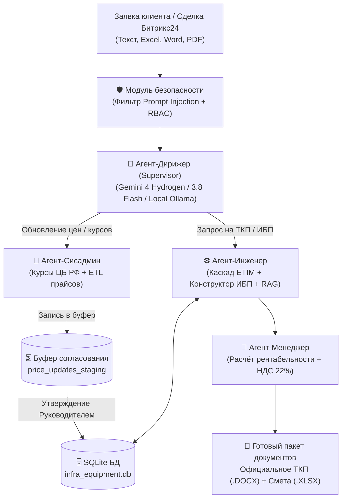
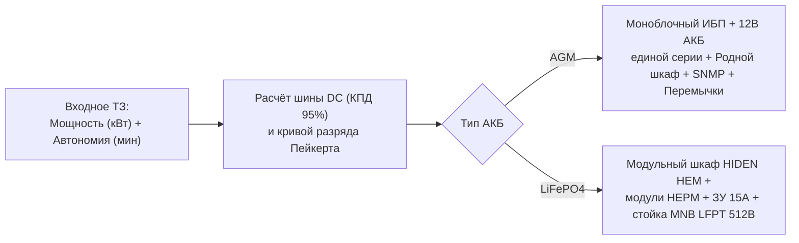

# ⚡ Инженерно-коммерческий ИИ-Штаб ООО «НИЦ «ИНФРА»

Автоматизированная система декомпозиции технических заданий (ТЗ), инженерного расчёта систем гарантированного электропитания (ИБП + АКБ) и формирования коммерческих предложений (ТКП) с интеграцией в CRM «Битрикс24».

## 1. Архитектура мультиагентного штаба

## 2. Алгоритм инженерного подбора ИБП (Brand & Ecosystem Lock)

## 3. Ролевая модель доступа (RBAC)
* **Руководитель (`director`):** полный доступ ко всем разделам, финансовой аналитике (закупочная себестоимость, маржа, внутренний `.XLSX`), настройке целевой рентабельности, утверждению прайсов в буфере `Staging` и журналу аудита.
* **Менеджер (`manager`):** расчёт ТКП по заявке клиента и выгрузка клиентского `.DOCX` по регламентной рентабельности, обновление курсов ЦБ РФ и отправка прайсов на согласование руководителю.1